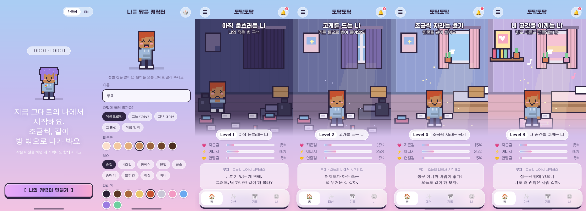
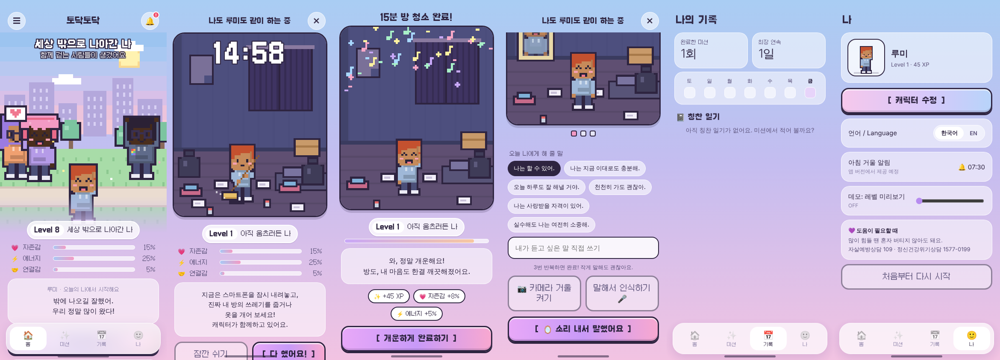

# 토닥토닥 (todottodot) — 기획 & 디자인

> 작은 자기돌봄 미션을 하면, 나를 닮은 레트로 픽셀 캐릭터가 함께 자라는 자존감 트레이닝 앱.
> 캐릭터가 화면 속에서 청소할 때, 나도 진짜 내 방을 청소한다 — "같이 해낸 느낌".

## 1. 핵심 루프
1. **오늘 마음 체크** (5단계 얼굴) → 기분에 맞는 미션 추천 (힘든 날 = 숨 고르기 / 물 한 잔, 좋은 날 = 산책·안부)
2. **미션 시작** → 캐릭터가 같은 행동을 함 (청소 = 빗질, 스트레칭, 물 마시기, 거울 앞 서기, 산책…)
3. 그동안 **나는 폰을 내려놓고 실제로 행동** (타이머가 함께 흐름, 청소 중엔 방 속 쓰레기가 점점 사라짐)
4. **완료** → XP·자존감/에너지/연결감 상승, 레벨업 시 새로운 장면이 열림

## 2. 성장 스토리 (5단계 장면)
| 레벨 | 장면 | 캐릭터 |
|---|---|---|
| Lv1 | **아직 움츠러든 나** — 어두운 방, 커튼 닫힘, 쓰레기 | 구석에 쪼그려 앉아 눈물, 웃지 않음 |
| Lv2–3 | **고개를 드는 나** — 커튼 틈으로 빛 | 일어섬, 무표정 |
| Lv4–5 | **조금씩 자라는 용기** — 창문 열림, 화분, 햇살 | 미소 |
| Lv6–7 | **내 공간을 아끼는 나** — 정돈된 방, 책장, 러그, 음악 | 웃음 |
| Lv8+ | **세상 밖으로 나아간 나** — 공원, 다른 사람들 | 조깅하는 사람, 스트레칭하는 사람, 대화하는 친구들과 함께 |

* 방은 하루가 지나면 살짝 다시 어질러짐 (삶은 원래 그래요) → 청소 미션의 의미 유지
* 미션도 단계적으로 열림: 혼자 할 수 있는 것 → 창문/스트레칭 → 산책 → 안부 메시지 → 모임 참여

## 3. 포용적인 캐릭터 만들기
* **성별 선택 없음.** 피부톤 7단계 · 헤어 9종(숏컷, 버즈컷, 롱, 단발, 곱슬, 똥머리, 모히칸, **히잡**, 비니) · 머리색 10가지(핑크/블루/민트 포함) · 체형 3종(마른/보통/통통) · 옷 색 · 포인트(안경, 주근깨, 귀걸이, **무지개 핀**, 헤드폰, 볼터치)
* **호칭 선택**: 이름으로만 / 그들(they) / 그녀 / 그 / 직접 입력 — 영어 버전에서 문장 생성에 사용
* 공원에 등장하는 이웃 캐릭터들도 다양한 인종·스타일로 랜덤 생성

## 4. 비주얼
* 레퍼런스: 하늘색 → 라벤더 → 핑크 파스텔 그라데이션 + 반투명 유리 카드
* 캐릭터·장면: **레트로 픽셀 (80×96 캔버스를 확대)**, 진보라 외곽선 — 이미지 파일 없이 코드로 그려서 조합이 무한함
* 제목/타이머/버튼: 픽셀 폰트 **Galmuri11** (OFL, 한글 지원) · 본문: 시스템 산세리프
* `[ 나랑 같이 방 청소하기 ]` 대괄호 픽셀 버튼

## 5. 구현된 미션
| 미션 | 방식 | 해금 |
|---|---|---|
| 🪞 거울 보고 말하기 | 확언 선택/직접 쓰기 → **3번 소리 내어 말하기**. 전면 카메라 거울 모드, 음성 인식(지원 브라우저) | Lv1 |
| 🫧 3분 숨 고르기 | 커졌다 작아지는 원을 따라 호흡 | Lv1 |
| 💧 물 한 잔 | 1분 타이머 | Lv1 |
| 🧹 15분 방 청소 | 타이머 + 캐릭터 빗질 + 방 쓰레기 점점 사라짐 | Lv1 |
| 📓 나 칭찬 일기 | 오늘 잘한 일 3가지 (기록 탭에 저장) | Lv1 |
| 🪟 창문 열고 햇볕 | 5분 | Lv2 |
| 🤸 5분 스트레칭 | 캐릭터 따라 하기 | Lv2 |
| 🚶 10분 산책 | 걷는 장면(배경 스크롤) | Lv4 |
| 💌 안부 한 줄 | 확인형 | Lv5 |
| 🫶 작은 모임 | 확인형, 친구들이 모여드는 장면 | Lv8 |

* 중간에 멈추면 혼내지 않음: "여기까지만 해도 괜찮아요" → 절반 보상
* 스탯은 줄어들지 않음 (벌점 없는 설계)
* 위기 상담 안내 (109 / 1577-0199) 상시 노출

## 6. 다음에 넣으면 좋을 기능 아이디어
* **아침 거울 알림** (07:30 푸시) + 잠금화면 위젯: 오늘의 확언
* **목소리 일기**: 확언을 녹음해 두고 힘든 날 *내 목소리로* 다시 듣기
* **"같이 하기" 방**: 친구/익명 유저와 같은 시간에 15분 청소 — 서로의 캐릭터가 한 화면에서 청소 (바디 더블링)
* **방 꾸미기**: 미션 보상으로 가구·화분·포스터 획득, 내 방을 직접 배치
* **옷장**: 레벨 보상 의상 (운동복, 정장, 파티룩) — 모임 장면에서 입기
* **작은 용기 사다리**: 편의점 가기 → 카페 주문하기 → 동네 수업 → 모임 (사회불안 노출 단계)
* **감정 날씨 캘린더**: 매일 기분을 픽셀 날씨로 기록, 한 달 돌아보기
* **나에게 편지**: 30일 뒤에 열리는 편지
* **수면 루틴 / 햇빛 시간** 연동 (HealthKit / Google Fit 걸음 수 → 산책 자동 완료)
* **캐릭터 대화**: 캐릭터가 오늘 한 일을 기억하고 말 걸어 주기
* 접근성: 휠체어·지팡이·보청기 등 액세서리, 색약 모드, 큰 글씨

## 7. 출시 로드맵
1. **지금**: 모바일 웹 프로토타입 (이 저장소, 한국어 기본 + 영어 전환)
2. PWA (홈 화면 추가, 오프라인, 알림)
3. Capacitor 또는 React Native로 감싸 **앱스토어/플레이스토어 한국 출시**
4. **영어 버전** — 문자열은 이미 `js/i18n.js`에 분리되어 있어 번역만 추가하면 됨 (호칭 they/she/he 반영)
